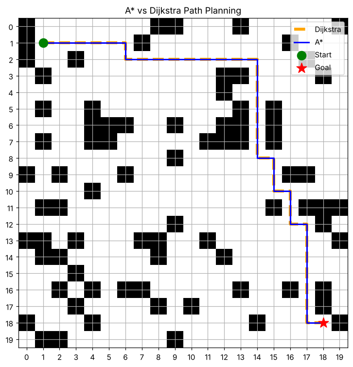

# PathForge

**A\* and Dijkstra path planning for a 2D grid robot simulator, with a C++ engine in progress.**

PathForge started as a Python simulator for comparing classic shortest-path algorithms on a robot's occupancy grid. It is now growing into a high-performance C++ planning engine with an interactive, browser-based visualiser (see the [roadmap](#roadmap)).



*A\* (blue) and Dijkstra (orange dashed) find the same 34-step route. On this map, A\* explores 226 cells and Dijkstra explores 315.*

---

## Key results

Average over 500 randomly generated maps per grid size, with 20% obstacle density, 4-directional movement and unit step cost:

| Grid size | A\* nodes explored | Dijkstra nodes explored | A\* saving | Path length |
|---|---:|---:|---:|---|
| 30 × 30 | ~483 | ~717 | **~33% fewer** | identical |
| 50 × 50 | ~1,290 | ~1,994 | **~35% fewer** | identical |

**What this shows:** A\*'s Manhattan-distance heuristic guides the search towards the goal, so it expands roughly a third fewer cells than Dijkstra. Both algorithms always return paths of the same length, which confirms that A\* is still optimal with this heuristic.

Node counts depend only on the maps, so they are reproducible on any machine. Timings in Python vary with hardware and system load, so the table uses node counts as the main comparison.

---

## Features

- **2D occupancy grid** with configurable size and random obstacle generation. Start and goal cells are always kept free.
- **A\* search** with an admissible, consistent Manhattan heuristic.
- **Dijkstra's algorithm** as an uninformed baseline.
- **Shared design across both planners:** a binary heap priority queue (`heapq`), lazy deletion of stale queue entries, and parent links to rebuild the path.
- **Visual comparison** of both routes on the same map with Matplotlib.
- **Benchmark script** that runs both planners on the same random maps and compares runtime, nodes explored and path length.

## How it works

| | Dijkstra | A\* |
|---|---|---|
| Queue priority | `g(n)`: cost from the start | `f(n) = g(n) + h(n)` |
| Heuristic | none | Manhattan distance to the goal |
| Search shape | spreads out evenly in all directions | stretches towards the goal |
| Optimal? | yes | yes, because the heuristic never overestimates |

Each planner pops the cheapest cell from the priority queue, skips it if it has already been settled, and pushes any neighbour whose cost has improved. When the goal is popped, the path is rebuilt by following parent links back to the start.

---

## Getting started

Requires Python 3.10+.

```bash
git clone https://github.com/trikzen/PathForge.git
cd PathForge
python -m venv .venv
source .venv/bin/activate        # Windows: .venv\Scripts\Activate.ps1
pip install -r requirements.txt
```

Run the visual comparison on a random 20×20 map:

```bash
python main.py
```

Run the benchmark (100 random 30×30 maps by default):

```bash
python benchmark.py
```

## Project structure

```text
PathForge/
├── main.py              # runs both planners on a random map and plots the routes
├── benchmark.py         # multi-map comparison of runtime, nodes explored and path length
├── src/
│   ├── environment.py   # 2D occupancy grid and obstacle generation
│   ├── astar.py         # A* search, neighbour generation and path reconstruction
│   ├── dijkstra.py      # Dijkstra's algorithm
│   ├── visualise.py     # Matplotlib route comparison
│   └── navigation.py    # dynamic replanning simulation (in progress)
├── tests/               # unit tests (being updated)
└── docs/                # images for this README
```

---

## Roadmap

The next stage rebuilds PathForge as a C++ engine. Robot planners often need to replan many times per second on modest onboard hardware, so speed and memory control matter, which is why C++ is the standard language in robotics.

### Stage 1: C++ core engine *(next)*
- [ ] Port A\* and Dijkstra to modern C++ (C++17, CMake), with a cache-friendly flat grid layout.
- [ ] Add a step-by-step planner interface, so a search can be advanced and inspected one expansion at a time.
- [ ] Add 8-directional movement and octile, Euclidean and Manhattan heuristics.
- [ ] Add unit tests with continuous integration on GitHub Actions.
- [ ] Benchmark C++ against this Python version on identical map files, checking that path lengths and nodes expanded match exactly. The Python code will stay in a `baseline/` folder for this comparison.
- [ ] Validate against the standard [MovingAI pathfinding benchmarks](https://movingai.com/benchmarks/grids.html), which publish optimal path lengths.

### Stage 2: Interactive visualiser and live web demo
- [ ] Build a Raylib + Dear ImGui app that animates the search live (open set, closed set, final path).
- [ ] Let users draw walls with the mouse, drag start and goal, and choose the algorithm and heuristic.
- [ ] Add a side-by-side mode to compare two planners on the same map.
- [ ] Compile to WebAssembly with Emscripten and host it as a **live demo in the browser**, with no install needed.

### Stage 3: Dynamic worlds
- [ ] Add **D\* Lite** for incremental replanning when obstacles appear, benchmarked against replanning from scratch with A\*.
- [ ] Add a robot with a limited sensing range that discovers the map as it moves.
- [ ] Add RRT and RRT\* sampling-based planners for continuous space.

### Future
- [ ] Hybrid A\* for car-like robots that can't turn on the spot.
- [ ] 3D drone path planning with octree maps and smooth, flyable trajectories.

---

## Author

**Ethan Leong**: [GitHub](https://github.com/trikzen) 
